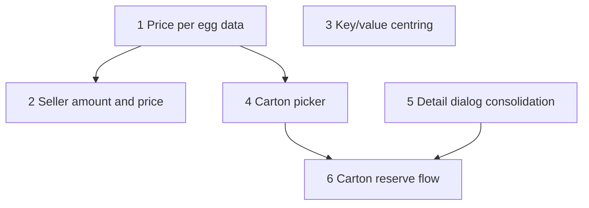

# Egg Pricing — Rollout

**Architecture:** [00-architecture.md](00-architecture.md) · **Decisions:** [gaps-and-decisions.md](gaps-and-decisions.md) · **Chapters:** [chapters/](chapters/) · **Ledger:** [run-ledger.md](run-ledger.md)

Chief of staff: invoke the **user** Cursor skill `chief-of-staff` with plan folder `.plans/egg-pricing/` (see `~/.cursor/skills/chief-of-staff/SKILL.md`). Each chapter runs via the **user** `chapter-implementer` agent.

**Loop branch:** `feat/plans-egg-pricing`

---

## Git invariants


| Invariant | Rule |
| --- | --- |
| **Release branch** | **`main`** — plan docs live here before the loop starts; **one** PR lands the full suite when all chapters are done. |
| **Loop branch** | **`feat/plans-egg-pricing`** — cut from pulled `main`; every chapter merges here first. |
| **Start of every chapter** | `git checkout feat/plans-egg-pricing && git pull` then `git checkout -b <branch from chapter doc>`. |
| **End of every chapter** | `./ci.sh` green → PR **into `feat/plans-egg-pricing`** → merge (user `chapter-implementer` agent). |
| **End of suite** | Chief opens PR **`feat/plans-egg-pricing` → `main`** after all chapters are on the loop branch with green CI. |

---

## Product invariants

1. **tdd-workflow** — red → green → refactor, one commit per green; files ≤~100 LOC, methods ≤~5 LOC, ≤1 nesting level, rule of three.
2. **Independently shippable** — each chapter merges with green `./ci.sh`.
3. **Price is per egg** — carton and order prices are always derived via `cartonPriceCents`, never stored.
4. **Cartons are 6 and 10** — `CARTON_SIZES` is the single source; no other quantity UI for buyers.
5. **Chakra-only** for touched UI; **no new npm dependencies**.
6. **German copy** via `strings.de.ts` only.
7. **One dialog surface** — listing detail renders inside `AppDialog`; no nested `Card` or Leaflet popup.
8. **Theme colours only** — egg icons use `eggColorForSlot`; no raw hex in features.
9. **TDD pair per chapter** — happy + negative in Red tests before Green; report refactor-gate outcome.

---

## Dependency graph



Chapter 3 has no dependencies.

---

## Chapters

| # | Chapter | Gate | Plan | Status |
| --- | --- | --- | --- | --- |
| 1 | Price per egg data | `./ci.sh` | [01-price-per-egg-data.md](chapters/01-price-per-egg-data.md) | planned |
| 2 | Seller amount and price | `./ci.sh` | [02-seller-amount-and-price.md](chapters/02-seller-amount-and-price.md) | planned |
| 3 | Key/value centring | `./ci.sh` | [03-key-value-centering.md](chapters/03-key-value-centering.md) | planned |
| 4 | Carton picker | `./ci.sh` | [04-carton-picker.md](chapters/04-carton-picker.md) | planned |
| 5 | Detail dialog consolidation | `./ci.sh` | [05-detail-dialog-consolidation.md](chapters/05-detail-dialog-consolidation.md) | planned |
| 6 | Carton reserve flow | `./ci.sh` | [06-carton-reserve-flow.md](chapters/06-carton-reserve-flow.md) | planned |

## Per-chapter gate

```bash
./ci.sh
```

---

## Execution order (chief of staff)

1. [chapters/01-price-per-egg-data.md](chapters/01-price-per-egg-data.md)
2. [chapters/02-seller-amount-and-price.md](chapters/02-seller-amount-and-price.md)
3. [chapters/03-key-value-centering.md](chapters/03-key-value-centering.md)
4. [chapters/04-carton-picker.md](chapters/04-carton-picker.md)
5. [chapters/05-detail-dialog-consolidation.md](chapters/05-detail-dialog-consolidation.md)
6. [chapters/06-carton-reserve-flow.md](chapters/06-carton-reserve-flow.md)
