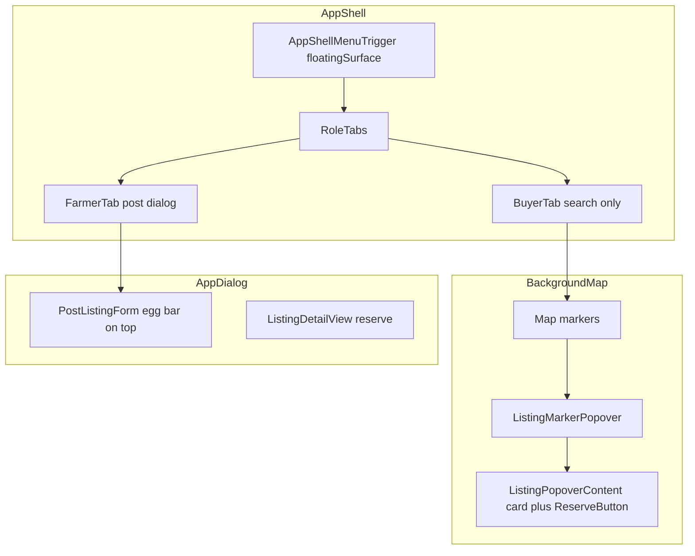

# Egg UX — Architecture

**Rollout:** [01-rollout.md](01-rollout.md) · **Decisions:** [gaps-and-decisions.md](gaps-and-decisions.md) · **Chapters:** [chapters/](chapters/) · **Ledger:** [run-ledger.md](run-ledger.md)

**Status:** planned

---

## 1. Why

Quantity is currently shown as **Braille** (`src/lib/braille/eggQuantity/`), which is hard to read at a glance. The shell **burger** trigger uses hardcoded light colours and can disappear on the map. The **Ort** combobox stays open after selection. **Post listing** still offers Stück/Dutzend and a 1–12 slider inside a **KeyValueRow**. **Listing cards** show a **Status** row (“Verfügbar”) instead of focusing on **available count**; the **map popover** renders only `ListingCard` inside a single button, so **reserve + amount slider** never appear there (they remain on `ListingDetailView` only). Listings default to **three-day** expiry; product wants **24 hours**.

This suite replaces Braille with a **decade egg row** (`TbEgg` / `TbEggFilled`), introduces an **Easter egg colour system** with **light/dark** semantics (redtape-style Chakra theme + [color mode](https://www.chakra-ui.com/docs/components/concepts/color-mode)), and closes the UX gaps above without payments or new map providers.

## 2. Non-goals

- No payments or new npm dependencies beyond **`next-themes`** (color mode).
- No mobile-specific layout pass.
- No edits to [`.plans/panel-ux/`](../panel-ux/) or [`.plans/minimal-panel/`](../minimal-panel/).
- Do not change partial-reserve **inventory rules** (already on `main`); only UI surfacing in popover.

## 3. Prerequisites

[frontend-structure](../frontend-structure/) is on `main`. [panel-ux](../panel-ux/) may be in flight or merged; this suite **supersedes Braille** wherever egg quantity is shown. Reference implementation patterns live in [redtape `apps/web/src/theme/`](../../redtape/apps/web/src/theme/) and [redtape floating controls](../../redtape/apps/web/src/components/layout/).

## 4. Feature layers (this suite)

| Layer | Responsibility | New / touched examples |
| --- | --- | --- |
| **theme** | Tokens, semantic colours, color mode | `src/theme/tokens/colors.ts`, `semantic-tokens/*`, `components/ui/color-mode.tsx` |
| **lib/eggQuantity** | Pure slot model for 1…100 | `slotsForCount.ts`, `render.test.ts` |
| **components/ui** | Presentational primitives | `EggQuantityRow`, `floatingSurface` (shell) |
| **shell** | Burger trigger styling | `AppShellMenuTrigger` |
| **location** | Ort combobox dismiss | `PlaceCombobox` |
| **listings** | Card, post form, reserve in popover | `ListingCard`, `PostListingForm`, `ListingMarkerPopover` / `ListingPopoverContent` |
| **supabase** | Default expiry | New migration (chapter 6 only) |

## 5. Egg decade display

One horizontal row of **10 slots** (indices `0…9`). Maximum count **100** → ten `TbEggFilled` icons. Icons from **`react-icons/tb`**: `TbEgg` (one egg), `TbEggFilled` (ten).

Let `n` be the count in `1…100`, `tens = floor(n / 10)`, `rem = n % 10`.

For each slot index `i`:

| Condition | Slot `i` |
| --- | --- |
| `i < tens` | `TbEggFilled` |
| `i >= tens` and `i < tens + rem` | `TbEgg` (outline) |
| otherwise | empty (spacer) |

**Examples:**

| `n` | Row (left → right) |
| ---: | --- |
| 9 | nine outlines in slots 0–8 |
| 10 | one filled in slot 0 |
| 15 | filled slot 0; outlines in slots 1–5 |
| 20 | filled in slots 0–1 |
| 100 | filled in all ten slots |

**Colour:** Each occupied slot uses a colour from the **12-name Easter palette** (see [gaps D3](gaps-and-decisions.md)), cycled by slot index (`palette[i % 12]`). Semantic tokens supply light/dark hex via `_dark` partners so eggs stay vivid in both modes.

**Legacy `dozen` listings:** Display uses `totalEggsFromListing` until chapter 4 removes it; after chapter 7, new posts always use `each` with literal 1…100. For legacy rows, chapter 4 may keep a thin adapter `displayEggCount(listing)` capped at 100 for the row (document in gaps if count &gt; 100).

## 6. Colour system and typography

- Add **`next-themes`** and Chakra **color-mode** snippet (`npx @chakra-ui/cli snippet add color-mode` → `src/components/ui/color-mode.tsx`).
- Extend [`src/theme/index.ts`](../../src/theme/index.ts) with:
  - **`mode(base, dark)`** helper ([redtape reference](../../redtape/apps/web/src/theme/semantic-tokens/mode.ts))
  - **Token scales** for Easter names + primary/neutral ramps
  - **Semantic tokens**: `fg`, `fg.muted`, `bg`, `nav.bg`, `nav.border`, `brand.mark`, egg palette aliases
- Wrap the app in **`ColorModeProvider`** in [`main.tsx`](../../src/main.tsx) (inside or outside `ChakraProvider` per Chakra docs).
- Apply semantic **`color`** / **`colorPalette`** on typography and controls in touched files (chapters 1–3, 7–9); avoid hardcoded `gray.200` / `white` on floating chrome.

## 7. Listing and post UI

- **ListingCard (browse / popover):** **Heading** = full-width colourful `EggQuantityRow` for `listing.egg_count` (display total). Body: **available amount** (numeric + unit label) and **price** — **no** `StatusBadge` / status row.
- **PostListingForm:** `EggQuantityRow` + slider **first**, **`w="full"`**, **not** wrapped in `KeyValueRow`. Slider **1…100**, step 1. **No** Stück/Dutzend chips; submit **`unit: "each"`** always.
- **Reserve:** `ReserveAmountControl` uses `EggQuantityRow` + slider; **`max`** = `listing.egg_count`. **Map popover** hosts **`ReserveButton`** (or equivalent stack) beside/under card content — **not** inside a card-wide `<button>`.

## 8. Shell and location

- **Burger:** Shared **`floatingSurface`** props (semantic bg, border, icon colour) on [`AppShellMenuTrigger`](../../src/features/shell/components/AppShell/AppShellMenuTrigger.tsx); keep **`TbMenu2`** unless contrast tests fail. Pattern: [redtape `floatingSurface.ts`](../../redtape/apps/web/src/components/layout/floatingSurface.ts), [redtape `AppMenu.tsx`](../../redtape/apps/web/src/components/layout/AppMenu.tsx).
- **PlaceCombobox:** After a town is selected, the dropdown **closes** even when the input still shows the place name (fix controlled `open` vs `listOpen` derived only from query length).

## 9. Expiry

- New listings: **`expires_at` default `now() + interval '24 hours'`** (migration in chapter 6).
- Existing **`listing_expires_at_bound`** (`expires_at <= now() + interval '14 days'`) remains unless product changes seller extend UI.
- **`pg_cron`** `expire_listings-daily` unchanged.

## 10. Screen map



## 11. Verification

```bash
./ci.sh
```

Chapter 6: apply migration locally; ensure tests/fixtures match 24h default.

## 12. Execution

Run via the user `chief-of-staff` skill and `chapter-implementer` agent (plan folder `.plans/egg-ux/`). Track merges in [run-ledger.md](run-ledger.md).

**Git:** loop branch `feat/plans-egg-ux`; chapter MRs → loop; one release MR **`feat/plans-egg-ux` → `main`** when done ([01-rollout.md](01-rollout.md)).

## 13. Traceability (brief → chapter)

| Brief item | Chapter |
| --- | --- |
| Easter colour system + color mode | 1 |
| Burger visible on map | 2 |
| TbEgg / TbEggFilled row, max 100 | 3, 4 |
| Colourful egg bar | 1, 3 |
| Retire Braille | 4 |
| Combobox closes on select | 5 |
| 24h listing expiry | 6 |
| Post form: slider 1–100, no unit chips, egg bar on top full width | 7 |
| Listing card heading + no status | 8 |
| Popover reserve + slider | 9 |
