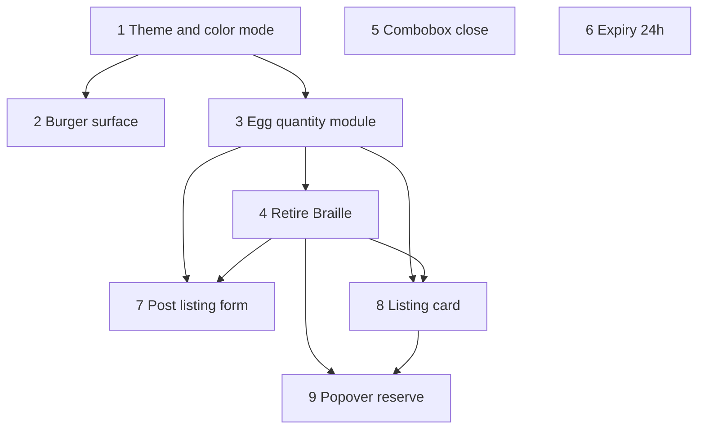

# Egg UX — Rollout

**Architecture:** [00-architecture.md](00-architecture.md) · **Decisions:** [gaps-and-decisions.md](gaps-and-decisions.md) · **Chapters:** [chapters/](chapters/) · **Ledger:** [run-ledger.md](run-ledger.md)

Chief of staff: invoke the **user** Cursor skill `chief-of-staff` with plan folder `.plans/egg-ux/` (see `~/.cursor/skills/chief-of-staff/SKILL.md`). Each chapter runs via the **user** `chapter-implementer` agent.

**Loop branch:** `feat/plans-egg-ux`

---

## Git invariants


| Invariant | Rule |
| --- | --- |
| **Release branch** | **`main`** — plan docs live here; **one** MR/PR lands the full suite when all chapters are done. |
| **Loop branch** | **`feat/plans-egg-ux`** — every chapter merges here first. |
| **Start of every chapter** | `git checkout feat/plans-egg-ux && git pull` then `git checkout -b <branch from chapter doc>`. |
| **End of every chapter** | `./ci.sh` green → MR/PR **into `feat/plans-egg-ux`** → merge (user `chapter-implementer` agent). |
| **End of suite** | Chief opens MR/PR **`feat/plans-egg-ux` → `main`** after all chapters are on the loop branch with green CI. |

---

## Product invariants

1. **Feature-folder layers** — containers orchestrate; components presentational; see architecture §4.
2. **Independently shippable** — each chapter merges with green `./ci.sh`.
3. **Chakra-only for touched UI** — Slider, Combobox, Popover, Field; no raw `<input>`/`<select>` in edited files.
4. **TDD pair per chapter** — happy + negative in Red tests table before Green.
5. **Refactor gate** — report outcome per chapter.
6. **German copy** via `strings.de.ts` only.
7. **Schema** — only chapter 6 touches `supabase/`.

---

## Dependency graph



---

## Chapters

| # | Chapter | Gate | Plan | Status |
| --- | --- | --- | --- | --- |
| 1 | Theme and color mode | `./ci.sh` | [01-theme-and-color-mode.md](chapters/01-theme-and-color-mode.md) | planned |
| 2 | Shell burger surface | `./ci.sh` | [02-shell-burger-surface.md](chapters/02-shell-burger-surface.md) | planned |
| 3 | Egg quantity module | `./ci.sh` | [03-egg-quantity-module.md](chapters/03-egg-quantity-module.md) | planned |
| 4 | Retire Braille | `./ci.sh` | [04-retire-braille.md](chapters/04-retire-braille.md) | planned |
| 5 | Place combobox close | `./ci.sh` | [05-place-combobox-close.md](chapters/05-place-combobox-close.md) | planned |
| 6 | Listing expiry 24h | `./ci.sh` | [06-listing-expiry-24h.md](chapters/06-listing-expiry-24h.md) | planned |
| 7 | Post listing form | `./ci.sh` | [07-post-listing-form.md](chapters/07-post-listing-form.md) | planned |
| 8 | Listing card quantity | `./ci.sh` | [08-listing-card-quantity.md](chapters/08-listing-card-quantity.md) | planned |
| 9 | Map popover reserve | `./ci.sh` | [09-map-popover-reserve.md](chapters/09-map-popover-reserve.md) | planned |

## Per-chapter gate

```bash
./ci.sh
```

Chapter 6: apply the new migration locally before `./ci.sh` if types or fixtures depend on DB defaults.

---

## Execution order (chief of staff)

1. [chapters/01-theme-and-color-mode.md](chapters/01-theme-and-color-mode.md)
2. [chapters/02-shell-burger-surface.md](chapters/02-shell-burger-surface.md)
3. [chapters/03-egg-quantity-module.md](chapters/03-egg-quantity-module.md)
4. [chapters/04-retire-braille.md](chapters/04-retire-braille.md)
5. [chapters/05-place-combobox-close.md](chapters/05-place-combobox-close.md)
6. [chapters/06-listing-expiry-24h.md](chapters/06-listing-expiry-24h.md)
7. [chapters/07-post-listing-form.md](chapters/07-post-listing-form.md)
8. [chapters/08-listing-card-quantity.md](chapters/08-listing-card-quantity.md)
9. [chapters/09-map-popover-reserve.md](chapters/09-map-popover-reserve.md)
