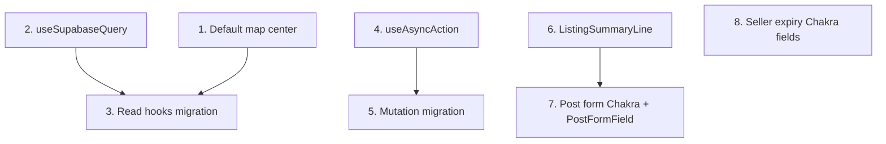

# Frontend DRY and Chakra — Rollout

**Architecture:** [00-architecture.md](00-architecture.md) · **Decisions:** [gaps-and-decisions.md](gaps-and-decisions.md) · **Chapters:** [chapters/](chapters/)

---

## Invariants

1. **No schema or backend change.**
2. **No intentional behavior change** — same RPCs, validation messages, empty states, and deep links.
3. **Independently shippable** — each chapter merges with green `./ci.sh`.
4. **Chakra-only for touched form UI** — `Field`, `Input`, `Textarea`, `Button`, `Text`; no raw `<label>`/`<input>` in files this chapter edits.
5. **TDD pair per chapter** — happy path + negative path in Red tests table before Green.
6. **Refactor gate** — report outcome; extract helpers instead of growing branchy components.

---

## Dependency graph



Chapters 1, 2, 4, 6, 7, 8 can ship without each other except where noted. Chapter 3 needs 2 (and benefits from 1). Chapter 5 needs 4. Chapter 7 benefits from 6 for card/detail consistency but can ship alone.

---

## Chapters

| # | Chapter | Gate | Plan | Status |
| --- | --- | --- | --- | --- |
| 1 | Default map center | `./ci.sh` | [01-default-map-center.md](chapters/01-default-map-center.md) | planned |
| 2 | useSupabaseQuery | `./ci.sh` | [02-use-supabase-query.md](chapters/02-use-supabase-query.md) | planned |
| 3 | Read hooks migration | `./ci.sh` | [03-read-hooks-migration.md](chapters/03-read-hooks-migration.md) | planned |
| 4 | useAsyncAction | `./ci.sh` | [04-use-async-action.md](chapters/04-use-async-action.md) | planned |
| 5 | Mutation migration | `./ci.sh` | [05-mutation-migration.md](chapters/05-mutation-migration.md) | planned |
| 6 | ListingSummaryLine | `./ci.sh` | [06-listing-summary-line.md](chapters/06-listing-summary-line.md) | planned |
| 7 | Post form Chakra + PostFormField | `./ci.sh` | [07-post-form-chakra.md](chapters/07-post-form-chakra.md) | planned |
| 8 | Seller expiry Chakra fields | `./ci.sh` | [08-seller-expiry-chakra.md](chapters/08-seller-expiry-chakra.md) | planned |

## Per-chapter gate

```bash
npm run lint && npm run typecheck && npm run test -- --run && npm run build
./ci.sh
```

**Git:** `feat/eggs-dry-<slug>` or `feat/eggs-chakra-<slug>` from updated `main`; conventional commits; one PR per chapter.
