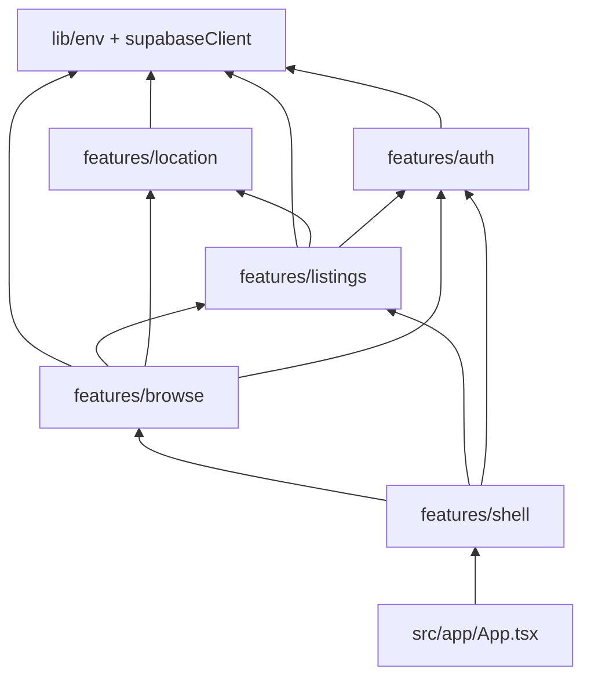

# Frontend structure — Architecture

**Rollout:** [01-rollout.md](01-rollout.md) · **Decisions:** [gaps-and-decisions.md](gaps-and-decisions.md) · **Chapters:** [chapters/](chapters/)

---

## 1. Why

The MVP and UI-overhaul plans shipped a working Eierbauer app (~1,800 LOC under `src/`), but the code
still reads like a scaffold: global `components/`, `hooks/`, `lib/`, and `routes/` folders, Supabase
calls scattered through components, and many screens defining several React components in one file.

[rsb-test-storage](https://code.rsint.net/inneRSource/python/rsb-test-storage)’s **current** frontend
(the code under `frontend/src/features/`, not the older flat tree in arc42) is the reference: each
product area is a feature folder with `containers/`, `components/`, `hooks/`, `services/`, `types/`,
and `utils/`, plus shared UI under `src/components/`. Eggs is small enough to adopt that shape without
a monorepo — the goal is maintainability and a clear place for the next features (e.g. “my listings” in
[ui-overhaul/gaps-and-decisions.md](../ui-overhaul/gaps-and-decisions.md)).

This folder is **structure only**. Chakra markup cleanup (raw `<label>` in `PostListing.tsx`) stays in
[ui-overhaul](../ui-overhaul/); do not mix those edits into these chapters.

## 2. Non-goals

- No changes under `supabase/` — RPC names, tables, and RLS stay as in `.plans/mvp/`.
- No new user-facing capability, copy, or routing behavior (paths `/`, `/post`, `/listings/:id` unchanged).
- No new npm dependencies beyond what alias configuration needs (Vite/tsconfig `paths` only).
- No rewrite of historical plan path references in `.plans/mvp/` or `.plans/ui-overhaul/` — after this
  work lands, **this folder** is the source of truth for where files live.
- No eslint `import/no-restricted-paths` enforcement yet — deferred until chapter 15 (see
  [gaps-and-decisions.md](gaps-and-decisions.md)).

## 3. Reference model (rsb-test-storage)

| Layer | Responsibility | Eggs analogue after restructure |
| --- | --- | --- |
| **Container** | URL/deep-link state, session, data hooks, orchestration; passes plain props to views | `BuyerTab`, `ListingDetail`, `PostListing` (container half) |
| **Component** | Presentational UI; no direct Supabase client | `ListingDetailView`, `ListingCard`, `RadiusSelect` |
| **Hook** | Stateful logic reused by containers or other hooks | `useListingsNear`, `useListing`, `useSession` |
| **Service** | I/O boundary: Supabase RPC/table calls, external HTTP | `listingsApi`, `geocodeApi` |
| **Types** | Domain TypeScript types and DTO shapes | `Listing`, `ListingNear`, `PlaceCandidate` |
| **Utils** | Pure functions (format, validate, map args) | `formatPrice`, `validateListingInput`, `toCreateListingArgs` |
| **Context** | Cross-cutting React context for a feature shell | `AppDialogProvider`, `BackgroundMapProvider` |

**Nested components** (observed in rsb `ActivityDrawer/`, `ReportGenerateModal/`, `CorpusUploadDialog/`):

1. If a component has **named sub-components** (separate functions that render UI), it becomes a **directory**
   named after the parent; the parent file composes children only.
2. Each sub-component gets **its own file**. If a sub-component has its own parts, nest another directory
   (e.g. `Table/TableRow/cells/`).
3. Every such directory has an **`index.ts`** barrel: default export plus named re-exports where useful.
4. **Leaf** components with no child components stay a **single file** — do not create a one-file folder
   (e.g. keep `StatusBadge.tsx`, not `StatusBadge/StatusBadge.tsx`).
5. **Data hooks** live under the feature’s `hooks/`, not as functions inside `.tsx` files.
6. **Views** do not import `supabaseClient`; containers and services do.

## 4. Target directory tree

```text
src/
  main.tsx
  app/
    App.tsx                         # Route table only (today: src/App.tsx)
  components/
    ui/toaster.tsx                  # Cross-feature chrome (unchanged location)
  lib/
    env.ts
    supabaseClient.ts               # Shared client only — no domain types here
  i18n/                             # Unchanged
  theme/                            # Unchanged
  test/setup.ts                     # Unchanged
  features/
    auth/
      components/AuthButton.tsx, RequireAuth.tsx
      hooks/useSession.ts
    location/
      components/LocationPicker/    # CandidateList, ManualPinFallback, LocationPicker.tsx, index.ts
      hooks/useSearchCandidates.ts
      services/geocodeApi.ts        # today: lib/geocode.ts
      types/place.ts                # PlaceCandidate, ConfirmedPin
    listings/
      containers/ListingDetail.tsx, PostListing.tsx
      components/
        ListingDetail/ListingDetailView.tsx
        PostListing/PostListingForm.tsx, FieldError.tsx
        ListingCard.tsx, StatusBadge.tsx
        ContactReveal.tsx
        SellerActions/              # MarkStatusActions, ExpiryEditor, SellerActions.tsx, index.ts
        ReserveButton/              # moved from src/components/ReserveButton/
      hooks/useListing.ts, useListingContact.ts, useActiveReservation.ts
      services/listingsApi.ts
      types/listing.ts, listingInput.ts
      utils/formatListing.ts, validateListingInput.ts, postListingMappers.ts
    browse/
      containers/BuyerTab.tsx
      components/
        BuyerTab/RadiusSelect.tsx, ResultsGrid.tsx
        MapView/MapView.tsx, Recenter.tsx
        ListingCard.tsx             # re-export or live here if shared — see chapter 13
      hooks/useGeolocation.ts, useListingsNear.ts
      services/browseApi.ts         # listings_near RPC wrapper
      types/geo.ts                  # GeoPoint if not shared from hook module
    shell/
      containers/AppShell.tsx       # thin composition root
      components/
        AppDialog/AppDialog.tsx
        AppShell/                   # MenuButton, Panel, DialogHost, BackgroundMapLayer, index.ts
        RoleTabs.tsx
        FarmerTab/AddListingTrigger.tsx, FarmerTab.tsx, index.ts
      context/appDialog.tsx, backgroundMap.tsx   # today: AppDialogState, BackgroundMap providers
```

**Note:** `ListingCard` and `StatusBadge` are listing-domain presentation but are consumed heavily by
browse; chapter 13 places them under `features/listings/components/` and imports them from browse (see
dependency rules below).

## 5. Dependency direction

One-way imports only:



- Features **must not** import another feature’s **containers** (orchestration stays local).
- Browse may import listings **components**, **types**, and **utils** (e.g. `ListingCard`, `ListingNear`).
- Listings may import **location** components/types and **auth** hooks.
- Shell composes tabs, dialogs, and map chrome; it imports listing containers for dialog content.

## 6. Why `location` is its own feature

Both the buyer tab and the post form use `LocationPicker`, debounced Nominatim search, and manual pin
fallback. Placing location inside `browse` or `listings` would force the other feature to depend on a
screen it does not own. Shared geocoding and picker UI belong in `features/location/`.

## 7. Audit — today’s layout (summary)

| Area | Today | Issue |
| --- | --- | --- |
| Routing | `src/App.tsx` + `src/routes/*` | Route targets mix with page logic |
| Auth | `src/auth/*` | Not under `features/` |
| Data | Supabase in hooks/components | No `services/` layer |
| Types | `src/lib/listing.ts` + validators | Types mixed with formatters |
| Shell | `AppShell.tsx` with 4 inline components | Violates nested-component rule |
| Buyer | `BuyerTab.tsx` with `RadiusSelect`, `ResultsGrid` | Inline sub-components |
| Post | `PostListing.tsx` 171 LOC, inline `FieldError`, RPC in container | Container/view not split |
| Detail | `ListingDetail.tsx` with inline `useListing` | Hook + container + view in one file |
| Picker | `LocationPicker.tsx` with `CandidateList`, `ManualPinFallback`, inline hook | Should be feature + folder |
| Reserve | `ReserveButton/` only good nested folder | `useActiveReservation` still inside button file |

Co-located tests (`src/**/*.test.{ts,tsx}`) and `src/test/setup.ts` stay; each move carries its tests.
No `@/` alias yet ([tsconfig.json](../../tsconfig.json), [vite.config.ts](../../vite.config.ts)).

## 8. File map — current → target

| Current path | Target (after all chapters) |
| --- | --- |
| `src/App.tsx` | `src/app/App.tsx` |
| `src/auth/AuthButton.tsx` | `src/features/auth/components/AuthButton.tsx` |
| `src/auth/RequireAuth.tsx` | `src/features/auth/components/RequireAuth.tsx` |
| `src/auth/useSession.ts` | `src/features/auth/hooks/useSession.ts` |
| `src/lib/listing.ts` | `src/features/listings/types/listing.ts` + `utils/formatListing.ts` |
| `src/lib/validateListingInput.ts` | `src/features/listings/utils/validateListingInput.ts` + types in `types/listingInput.ts` |
| `src/lib/geocode.ts` | `src/features/location/services/geocodeApi.ts` + `types/place.ts` |
| `src/hooks/useGeolocation.ts` | `src/features/browse/hooks/useGeolocation.ts` |
| `src/hooks/useListingsNear.ts` | `src/features/browse/hooks/useListingsNear.ts` + `services/browseApi.ts` |
| `src/routes/ListingDetail.tsx` | `src/features/listings/containers/ListingDetail.tsx` + view folder |
| `src/routes/PostListing.tsx` | `src/features/listings/containers/PostListing.tsx` + form folder |
| `src/components/ReserveButton/*` | `src/features/listings/components/ReserveButton/*` |
| `src/components/ContactReveal.tsx` | `src/features/listings/components/ContactReveal.tsx` |
| `src/components/SellerActions.tsx` | `src/features/listings/components/SellerActions/*` |
| `src/components/ListingCard.tsx` | `src/features/listings/components/ListingCard.tsx` |
| `src/components/StatusBadge.tsx` | `src/features/listings/components/StatusBadge.tsx` |
| `src/components/LocationPicker.tsx` | `src/features/location/components/LocationPicker/*` |
| `src/components/BuyerTab.tsx` | `src/features/browse/containers/BuyerTab.tsx` + `BuyerTab/*` |
| `src/components/MapView.tsx` | `src/features/browse/components/MapView/*` |
| `src/components/AppShell.tsx` | `src/features/shell/containers/AppShell.tsx` + `AppShell/*` |
| `src/components/AppDialog.tsx` | `src/features/shell/components/AppDialog/*` |
| `src/components/AppDialogState.tsx` | `src/features/shell/context/appDialog.tsx` |
| `src/components/BackgroundMap.tsx` | `src/features/shell/context/backgroundMap.tsx` |
| `src/components/RoleTabs.tsx` | `src/features/shell/components/RoleTabs.tsx` |
| `src/components/FarmerTab.tsx` | `src/features/shell/components/FarmerTab/*` |
| `src/components/UnitSelect.tsx` | Stays imported by post form — `src/features/listings/components/UnitSelect.tsx` (moved with listings in ch. 10) |

## 9. Import alias

After chapter 1, prefer `@/` for imports rooted at `src/` (e.g. `@/features/listings/types/listing`).
Relative imports within a feature folder remain fine for siblings. The alias reduces `../../` churn during
moves.

## 10. Verification baseline

Every chapter’s gate is the same as `.plans/mvp/` and `.plans/ui-overhaul/`:

```bash
npm run lint && npm run typecheck && npm run test -- --run && npm run build
./ci.sh
```

Manual smoke after structural chapters that touch shell or browse: open `/`, search, open a listing dialog,
post a listing (signed in), reserve flow unchanged.
