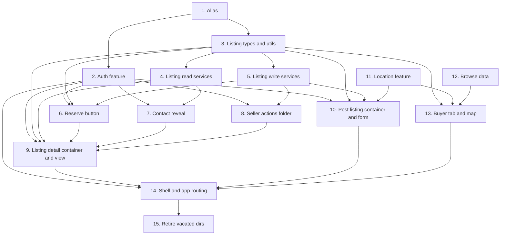

# Frontend structure — Rollout

**Architecture:** [00-architecture.md](00-architecture.md) · **Decisions:** [gaps-and-decisions.md](gaps-and-decisions.md) · **Chapters:** [chapters/](chapters/)

---

## The six invariants

1. **No schema or backend change.** Nothing under `supabase/` is touched; RPC and table usage stays identical.
2. **No user-visible behavior change.** Browse, post, detail dialog, reserve, seller actions, and deep links behave as today.
3. **Independently shippable.** After each chapter, `main` builds, `./ci.sh` is green, and the app is deployable.
4. **Same-chapter cutover.** New paths wired and old files deleted in one PR — no re-export shims (D6).
5. **Nested-component gate.** Any file this chapter touches that defines two or more React components must be split into the hierarchical layout from [00-architecture.md §3](00-architecture.md#3-reference-model-rsb-test-storage) before merge.
6. **Tests travel together.** Co-located tests update imports with the module; red/green pairs per [tdd](../../../.cursor/rules/tdd.mdc) stay satisfied for the slice the chapter moves.

---

## Dependency graph



Chapter 1 has no feature dependency. Chapters 2–3 can start after 1. Location (11) must precede buyer tab (13) and post form (10) picker imports. Shell (14) waits on listing containers and browse. Cleanup (15) is last.

---

## Chapters

| # | Chapter | Layer | Gate | Plan | Status |
| --- | --- | --- | --- | --- | --- |
| 1 | `@/` import alias | frontend tooling | vitest + `./ci.sh` | [01-import-alias.md](chapters/01-import-alias.md) | planned |
| 2 | Auth feature | frontend | vitest + `./ci.sh` | [02-auth-feature.md](chapters/02-auth-feature.md) | planned |
| 3 | Listing types and pure utils | frontend | vitest + `./ci.sh` | [03-listing-types-utils.md](chapters/03-listing-types-utils.md) | planned |
| 4 | Listing read services | frontend | vitest + `./ci.sh` | [04-listing-read-services.md](chapters/04-listing-read-services.md) | planned |
| 5 | Listing write services | frontend | vitest + `./ci.sh` | [05-listing-write-services.md](chapters/05-listing-write-services.md) | planned |
| 6 | Reserve button | frontend | vitest + `./ci.sh` | [06-reserve-button.md](chapters/06-reserve-button.md) | planned |
| 7 | Contact reveal | frontend | vitest + `./ci.sh` | [07-contact-reveal.md](chapters/07-contact-reveal.md) | planned |
| 8 | Seller actions folder | frontend | vitest + `./ci.sh` | [08-seller-actions-folder.md](chapters/08-seller-actions-folder.md) | planned |
| 9 | Listing detail container and view | frontend | vitest + `./ci.sh` | [09-listing-detail-container-view.md](chapters/09-listing-detail-container-view.md) | planned |
| 10 | Post listing container and form | frontend | vitest + `./ci.sh` | [10-post-listing-container-form.md](chapters/10-post-listing-container-form.md) | planned |
| 11 | Location feature | frontend | vitest + `./ci.sh` | [11-location-feature.md](chapters/11-location-feature.md) | planned |
| 12 | Browse data layer | frontend | vitest + `./ci.sh` | [12-browse-data.md](chapters/12-browse-data.md) | planned |
| 13 | Buyer tab and map | frontend | vitest + `./ci.sh` | [13-buyer-tab-and-map.md](chapters/13-buyer-tab-and-map.md) | planned |
| 14 | Shell and app routing | frontend | vitest + `./ci.sh` | [14-shell-and-app-routing.md](chapters/14-shell-and-app-routing.md) | planned |
| 15 | Retire vacated directories | frontend | vitest + `./ci.sh` | [15-retire-vacated-dirs.md](chapters/15-retire-vacated-dirs.md) | planned |

"Shipped" means the chapter code is on `main` and the chapter doc’s refactor gate outcome is recorded.
"Planned" means the executable doc exists but no restructuring PR has merged yet — all fifteen start as
planned.

## Per-chapter gate

```bash
npm run lint && npm run typecheck && npm run test -- --run && npm run build
./ci.sh
```

No chapter touches `supabase/migrations/` — no db reset or RLS smoke extension required.

**Refactor gate** (reported per chapter): audit the containing file or class moved in that chapter — ~5 LOC
per function where practical, ~100 LOC per file, one nesting level, rule-of-three branches extracted — same
spirit as `.plans/mvp/01-rollout.md` and `.plans/ui-overhaul/01-rollout.md`.

**Git:** `git checkout main && git pull`, then `git checkout -b feat/eggs-fs-<chapter-slug>`. Conventional
commits: `test(web): …` then `refactor(web): …` (or `chore(web):` for chapter 1). One PR per chapter; never
commit directly to `main`.
