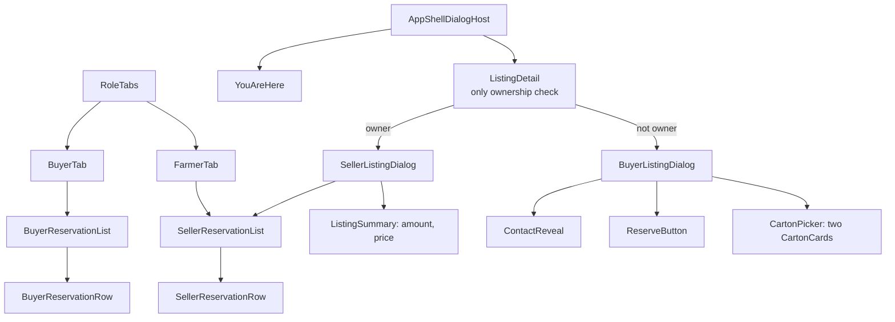

# Lean UI — Architecture

**Rollout:** [01-rollout.md](01-rollout.md) · **Decisions:** [gaps-and-decisions.md](gaps-and-decisions.md) · **Chapters:** [chapters/](chapters/) · **Ledger:** [run-ledger.md](run-ledger.md)

**Status:** planned

---

## 1. Why

The UI shows information users cannot act on. The buyer dialog lists available eggs, price per egg and a status badge, then a 4-column radio grid of cartons; a buyer can only reserve what is available, and the carton price is already computed. Sellers and anonymous viewers see a `Status` row although a listing is either visible or not visible at all. The "Zum Reservieren anmelden" button is `disabled`, so signed-out viewers cannot sign in from the place that asks them to. Reservations are only visible inside a listing dialog, which breaks for fully-reserved listings (hidden by [listing-roles](../listing-roles/)). The user-location marker is unlabelled in German.

## 2. Non-goals

- No schema, RLS or RPC changes. Reservation lists use existing tables and policies (`reservation_select_participant`, public `listing` select). If chapter 2 finds `listing_contact` is not readable by an active-reservation buyer, that is reported as a blocker, not fixed here.
- No new npm dependencies; Chakra-only for touched UI; German copy only in [`strings.de.ts`](../../src/i18n/strings.de.ts).
- No seller actions (reservations stay read-only), no buyer identity shown to sellers.
- No change to the 6/10 carton rules ([`carton.ts`](../../src/features/listings/utils/carton.ts)) or the listing lifecycle.

## 3. Target component map



Role logic stays in `ListingDetail`. Seller and buyer reservation rows are separate components; neither checks ownership.

## 4. Reservation data

| Query | Source | Filter | Used by |
| --- | --- | --- | --- |
| `fetchSellerReservations` | `reservation` ⋈ `listing` | `status = 'active'`, `listing.seller_id = auth.uid()`, `listing.expires_at > now()` | `FarmerTab`, `SellerListingDialog` (per listing) |
| `fetchBuyerReservations` | `reservation` ⋈ `listing` ⋈ `listing_contact` | `status = 'active'`, `buyer_id = auth.uid()`, `listing.expires_at > now()` | `BuyerTab` |

Rows carry the listing's `location_label` so they read without opening the (possibly hidden) listing. Cancelled reservations are never shown.

## 5. Layers

| Layer | Touched |
| --- | --- |
| **features/listings** | `components/{CartonPicker,ListingSummary,ReserveButton,SellerReservationList,BuyerReservationList}`, `containers/{BuyerListingDialog,SellerListingDialog}`, `hooks/{useSellerReservations,useBuyerReservations}`, `services/listingsApi`; **removed** `components/StatusBadge` |
| **features/auth** | `services/signInWithGoogle`, `components/AuthButton` |
| **features/shell** | `components/FarmerTab`, `components/AppShell/AppShellDialogHost`, `context/appDialog`, new `components/YouAreHere` |
| **features/browse** | `containers/BuyerTab`, `components/MapView/MapView`, `context/backgroundMap` consumers |
| **i18n** | `strings.de.ts` |

## 6. Verification

```bash
./ci.sh
```

Chapter 7 ends with a manual pass: post as seller, reserve a carton from a second account, see the reservation in both panels, cancel it from the buyer panel and watch it leave the seller panel, click the basket marker.

## 7. Execution

Run via [`.claude/skills/chief-of-staff/SKILL.md`](../../.claude/skills/chief-of-staff/SKILL.md) and [`.claude/agents/chapter-implementer.md`](../../.claude/agents/chapter-implementer.md) (plan folder `.plans/lean-ui`). Track merges in [run-ledger.md](run-ledger.md).

**Git:** loop branch `feat/plans-lean-ui`; chapter PRs → loop; one release PR **`feat/plans-lean-ui` → `main`** when done ([01-rollout.md](01-rollout.md)).

## 8. Traceability (brief → chapter)

| Brief item | Chapter |
| --- | --- |
| Buyer: drop available and price-per-egg | 1 |
| Buyer: only 6/10 cards, 2×1 grid, no radios, whole-card highlight, rounded | 2 |
| Contact hint appears after reservation | 2 |
| Remove `Status` for seller and anonymous view | 1 |
| "Zum Reservieren anmelden" goes to login | 3 |
| "You are here" marker opens a standard dialog (German) | 4 |
| Reservation data for panel lists | 5 |
| Seller: reservations in the panel and in the listing card | 6 |
| Buyer: reservations in the Buyer card | 7 |
| Separate seller and buyer listing/reservation components | 6, 7 |
| Docs | 8 |
