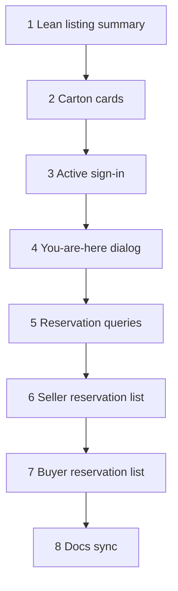

# Lean UI — Rollout

**Architecture:** [00-architecture.md](00-architecture.md) · **Decisions:** [gaps-and-decisions.md](gaps-and-decisions.md) · **Chapters:** [chapters/](chapters/) · **Ledger:** [run-ledger.md](run-ledger.md)

Chief of staff: invoke the **user** Cursor skill `chief-of-staff` with plan folder `.plans/lean-ui/` (see `~/.cursor/skills/chief-of-staff/SKILL.md`). Each chapter runs via the **user** `chapter-implementer` agent.

**Loop branch:** `feat/plans-lean-ui`

---

## Git invariants


| Invariant | Rule |
| --- | --- |
| **Release branch** | **`main`** — plan docs live here before the loop starts; **one** PR lands the full suite when all chapters are done. |
| **Loop branch** | **`feat/plans-lean-ui`** — cut from pulled `main`; every chapter merges here first. |
| **Start of every chapter** | `git checkout feat/plans-lean-ui && git pull` then `git checkout -b <branch from chapter doc>`. |
| **End of every chapter** | `./ci.sh` green → PR **into `feat/plans-lean-ui`** → merge (user `chapter-implementer` agent). |
| **End of suite** | Chief opens PR **`feat/plans-lean-ui` → `main`** after all chapters are on the loop branch with green CI. |

---

## Product invariants

1. **tdd-workflow** — red → green → refactor, one commit per green; files ≤~100 LOC, methods ≤~5 LOC, ≤1 nesting level, rule of three; one component per file, directories mirror the hierarchy.
2. **Independently shippable** — each chapter merges with green `./ci.sh`.
3. **No schema changes** — no migration, RLS or RPC edits.
4. **Role logic in one place** — only `ListingDetail` checks ownership; role containers, rows and lists never do. Seller and buyer components are separate files.
5. **Show only actionable information** — no listing status, no available count, no price per egg in the buyer view.
6. **Rounded, themed surfaces** — new cards use the existing recipe/tokens (`rounded`, `colorPalette`), no hard-coded colours.
7. **Chakra-only**, **no new npm dependencies**, German copy via `strings.de.ts` only (including map marker titles).
8. **TDD pair per chapter** — happy + negative in Red tests before Green; report refactor-gate outcome.
9. **Read-only reservation lists** — active reservations on non-expired listings only; rows are not clickable.

---

## Dependency graph



Chapter 4 does not depend on 1–3 technically; it is ordered linearly to keep the loop simple.

---

## Chapters

| # | Chapter | Gate | Plan | Status |
| --- | --- | --- | --- | --- |
| 1 | Lean listing summary | `./ci.sh` | [01-lean-listing-summary.md](chapters/01-lean-listing-summary.md) | shipped |
| 2 | Carton cards | `./ci.sh` | [02-carton-cards.md](chapters/02-carton-cards.md) | shipped |
| 3 | Active sign-in | `./ci.sh` | [03-active-signin.md](chapters/03-active-signin.md) | shipped |
| 4 | You-are-here dialog | `./ci.sh` | [04-you-are-here-dialog.md](chapters/04-you-are-here-dialog.md) | shipped |
| 5 | Reservation queries | `./ci.sh` | [05-reservation-queries.md](chapters/05-reservation-queries.md) | shipped |
| 6 | Seller reservation list | `./ci.sh` | [06-seller-reservation-list.md](chapters/06-seller-reservation-list.md) | shipped |
| 7 | Buyer reservation list | `./ci.sh` | [07-buyer-reservation-list.md](chapters/07-buyer-reservation-list.md) | shipped |
| 8 | Docs sync | `./ci.sh` | [08-docs-sync.md](chapters/08-docs-sync.md) | shipped |

## Per-chapter gate

```bash
./ci.sh
```

---

## Reading of the brief (to confirm)

The brief's item "create different components for seller's and buyer's listings (in line for seller / …" was cut off. It is read as: separate seller and buyer components for reservation rows and lists, seller rows rendered inline (one line each), buyer rows with a cancel action ([D6](gaps-and-decisions.md)). Correct this before chapter 6 if the intent was different.

---

## Execution order (chief of staff)

1. [chapters/01-lean-listing-summary.md](chapters/01-lean-listing-summary.md)
2. [chapters/02-carton-cards.md](chapters/02-carton-cards.md)
3. [chapters/03-active-signin.md](chapters/03-active-signin.md)
4. [chapters/04-you-are-here-dialog.md](chapters/04-you-are-here-dialog.md)
5. [chapters/05-reservation-queries.md](chapters/05-reservation-queries.md)
6. [chapters/06-seller-reservation-list.md](chapters/06-seller-reservation-list.md)
7. [chapters/07-buyer-reservation-list.md](chapters/07-buyer-reservation-list.md)
8. [chapters/08-docs-sync.md](chapters/08-docs-sync.md)
