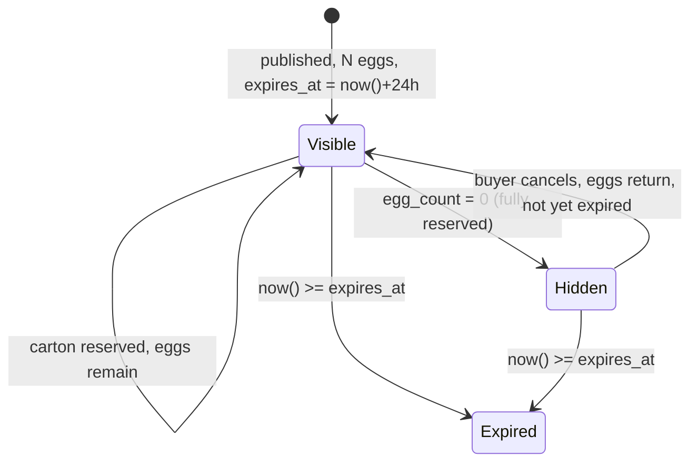
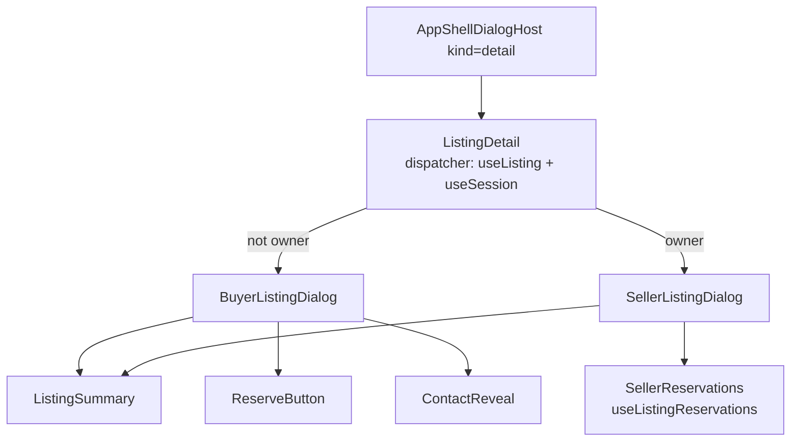

# Listing Roles — Architecture

**Rollout:** [01-rollout.md](01-rollout.md) · **Decisions:** [gaps-and-decisions.md](gaps-and-decisions.md) · **Chapters:** [chapters/](chapters/) · **Ledger:** [run-ledger.md](run-ledger.md)

**Status:** shipped

---

## 1. Why

One dialog serves both roles. [`ListingDetailView`](../../src/features/listings/components/ListingDetail/ListingDetailView.tsx) always renders [`ReserveButton`](../../src/features/listings/components/ReserveButton/ReserveButton.tsx), [`ContactReveal`](../../src/features/listings/components/ContactReveal.tsx) and [`SellerActions`](../../src/features/listings/components/SellerActions/SellerActions.tsx). Role is decided inside the leaves: `SellerActions` returns `null` for non-owners, while `ReserveButton` never checks ownership — a seller can reserve their own eggs. The `key={listing.status}` remount on `ContactReveal` is a symptom of the same entanglement.

Sellers also get manual controls (mark sold, withdraw, edit expiry). They are unnecessary: the lifecycle is fully automatic (§3).

## 2. Non-goals

- No payments, no buyer identity/contact exposed to sellers (the `reservation` row only carries `buyer_id`).
- No push/email notifications to sellers.
- No new npm dependencies; no theme changes; copy only in [`strings.de.ts`](../../src/i18n/strings.de.ts).
- No change to the carton (6/10) reserve mechanics from [egg-pricing](../egg-pricing/).

## 3. Lifecycle (automatic)



Rules:

- A listing is **visible** iff `status = 'active' and egg_count > 0 and expires_at > now()`.
- Reserving is only possible from the unreserved remainder and only while visible.
- Expiry is evaluated at query time. The daily `expire_listings()` cron stays as status cleanup only; it is not what hides listings.
- No sold/cancelled/expiry-edit paths remain in the API or UI.

## 4. Component structure

Before: `ListingDetail → ListingDetailView → {ReserveButton, ContactReveal, SellerActions}`.

After:



`ListingSummary` is the shared read-only block (amount, price, status). Role logic lives only in the dispatcher; leaves never check ownership.

## 5. Seller container

Shows: summary (total / reserved / remaining eggs, price per egg, expires at), the seller's own contact note, and the list of reservations (egg count, time, active/cancelled). RLS already lets the seller read reservations of their listing (`reservation_select_participant`). No actions.

## 6. Layers

| Layer | Touched |
| --- | --- |
| **supabase** | `migrations/<ts>_listing_visibility.sql`, `seed.sql`, `scripts/rls-smoke.ts` |
| **features/listings** | `containers/{ListingDetail,BuyerListingDialog,SellerListingDialog}`, `components/{ListingSummary,SellerReservations,ReserveButton,StatusBadge}`, `hooks/useListingReservations`, `services/listingsApi`; **removed** `components/SellerActions/*`, `ListingDetail/ListingDetailView` |
| **i18n** | `strings.de.ts` |

## 7. Verification

```bash
./ci.sh
```

Chapter 1 also runs `supabase db reset` and `scripts/rls-smoke.ts`. Chapter 4 ends with a manual pass: post, reserve from a second account, see the reservation as the seller, reserve the rest and watch the listing vanish from the map, cancel and watch it return.

## 8. Execution

Run via [`.claude/skills/chief-of-staff/SKILL.md`](../../.claude/skills/chief-of-staff/SKILL.md) and [`.claude/agents/chapter-implementer.md`](../../.claude/agents/chapter-implementer.md) (plan folder `.plans/listing-roles`). Track merges in [run-ledger.md](run-ledger.md).

**Git:** loop branch `feat/plans-listing-roles`; chapter PRs → loop; one release PR **`feat/plans-listing-roles` → `main`** when done ([01-rollout.md](01-rollout.md)).

## 9. Traceability (brief → chapter)

| Brief item | Chapter |
| --- | --- |
| Separate seller and buyer containers | 3, 4 |
| Remove mark sold / withdraw / save expiry | 1, 2 |
| Fully reserved → listing no longer visible | 1 |
| Expires after 24h regardless of remaining eggs | 1 |
| Other buyers reserve only from the unreserved amount | 1 (verified), 3 |
| No listing or expiry handling in the interface | 2 |
| Seller sees reservations | 4 |
