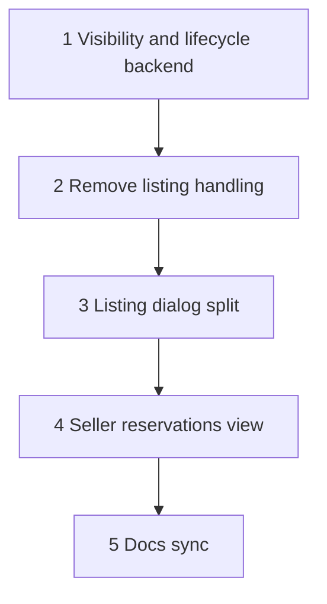

# Listing Roles — Rollout

**Architecture:** [00-architecture.md](00-architecture.md) · **Decisions:** [gaps-and-decisions.md](gaps-and-decisions.md) · **Chapters:** [chapters/](chapters/) · **Ledger:** [run-ledger.md](run-ledger.md)

Chief-of-staff runs chapters via [`.claude/skills/chief-of-staff/SKILL.md`](../../.claude/skills/chief-of-staff/SKILL.md) (plan folder `.plans/listing-roles`).

**Loop branch:** `feat/plans-listing-roles`

---

## Git invariants

Orchestration: [`.claude/skills/chief-of-staff/git-model.md`](../../.claude/skills/chief-of-staff/git-model.md).

| Invariant | Rule |
| --- | --- |
| **Release branch** | **`main`** — plan docs live here before the loop starts; **one** PR lands the full suite when all chapters are done. |
| **Loop branch** | **`feat/plans-listing-roles`** — cut from pulled `main`; every chapter merges here first. |
| **Start of every chapter** | `git checkout feat/plans-listing-roles && git pull` then `git checkout -b <branch from chapter doc>`. |
| **End of every chapter** | `./ci.sh` green → PR **into `feat/plans-listing-roles`** → merge ([`.claude/agents/chapter-implementer.md`](../../.claude/agents/chapter-implementer.md)). |
| **End of suite** | Chief opens PR **`feat/plans-listing-roles` → `main`** after all chapters are on the loop branch with green CI. |

---

## Product invariants

1. **tdd-workflow** — red → green → refactor, one commit per green; files ≤~100 LOC, methods ≤~5 LOC, ≤1 nesting level, rule of three.
2. **Independently shippable** — each chapter merges with green `./ci.sh`.
3. **Visible iff** `status = 'active' and egg_count > 0 and expires_at > now()` — enforced server-side.
4. **Role logic in one place** — only `ListingDetail` checks ownership; role containers and their leaves never do.
5. **No listing handling in the UI** — no sold, withdraw or expiry controls anywhere.
6. **Chakra-only** for touched UI; **no new npm dependencies**; German copy via `strings.de.ts` only.
7. **One dialog surface** — both containers render inside `AppDialog`.
8. **TDD pair per chapter** — happy + negative in Red tests before Green; report refactor-gate outcome.

---

## Dependency graph



---

## Chapters

| # | Chapter | Gate | Plan | Status |
| --- | --- | --- | --- | --- |
| 1 | Visibility and lifecycle backend | `./ci.sh` + `supabase db reset` + rls-smoke | [01-visibility-and-lifecycle-backend.md](chapters/01-visibility-and-lifecycle-backend.md) | shipped |
| 2 | Remove listing handling | `./ci.sh` | [02-remove-listing-handling.md](chapters/02-remove-listing-handling.md) | shipped |
| 3 | Listing dialog split | `./ci.sh` | [03-listing-dialog-split.md](chapters/03-listing-dialog-split.md) | shipped |
| 4 | Seller reservations view | `./ci.sh` | [04-seller-reservations-view.md](chapters/04-seller-reservations-view.md) | shipped |
| 5 | Docs sync | `./ci.sh` | [05-docs-sync.md](chapters/05-docs-sync.md) | shipped |

## Per-chapter gate

```bash
./ci.sh
```

---

## Execution order (chief of staff)

1. [chapters/01-visibility-and-lifecycle-backend.md](chapters/01-visibility-and-lifecycle-backend.md)
2. [chapters/02-remove-listing-handling.md](chapters/02-remove-listing-handling.md)
3. [chapters/03-listing-dialog-split.md](chapters/03-listing-dialog-split.md)
4. [chapters/04-seller-reservations-view.md](chapters/04-seller-reservations-view.md)
5. [chapters/05-docs-sync.md](chapters/05-docs-sync.md)
