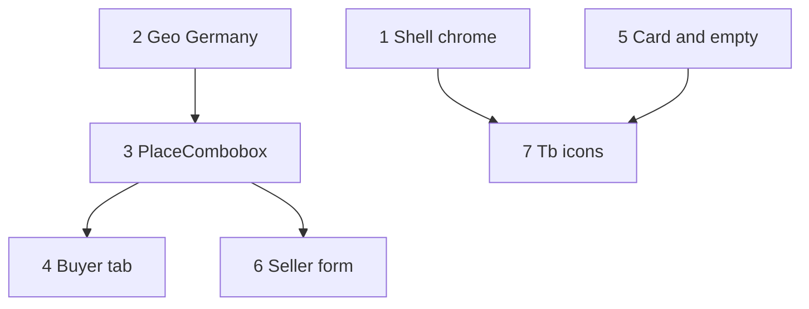

# Minimal panel — Rollout

**Architecture:** [00-architecture.md](00-architecture.md) · **Decisions:** [gaps-and-decisions.md](gaps-and-decisions.md) · **Chapters:** [chapters/](chapters/) · **Ledger:** [run-ledger.md](run-ledger.md)

Chief-of-staff runs chapters via [`.cursor/skills/chief-of-staff/SKILL.md`](../../.cursor/skills/chief-of-staff/SKILL.md) (plan folder `.plans/minimal-panel`).

---

## Invariants

1. **No schema or backend change.**
2. **Feature-folder layers** — containers orchestrate; components presentational; see architecture §4.
3. **Independently shippable** — each chapter merges with green `./ci.sh`.
4. **Chakra-only for touched UI** — Slider, Combobox, EmptyState, Field; no raw `<input>`/`<select>` in edited files.
5. **TDD pair per chapter** — happy + negative in Red tests table before Green.
6. **Refactor gate** — report outcome per chapter.
7. **German copy** via `strings.de.ts` only.

---

## Dependency graph



---

## Chapters

| # | Chapter | Gate | Plan | Status |
| --- | --- | --- | --- | --- |
| 1 | Shell chrome and roles | `./ci.sh` | [01-shell-chrome.md](chapters/01-shell-chrome.md) | planned |
| 2 | Geo user or Germany | `./ci.sh` | [02-geo-germany.md](chapters/02-geo-germany.md) | planned |
| 3 | Ort Combobox + target | `./ci.sh` | [03-place-combobox.md](chapters/03-place-combobox.md) | planned |
| 4 | Buyer grid + radius slider | `./ci.sh` | [04-buyer-tab.md](chapters/04-buyer-tab.md) | planned |
| 5 | Empty state + listing card | `./ci.sh` | [05-listing-card.md](chapters/05-listing-card.md) | planned |
| 6 | Seller form simplified | `./ci.sh` | [06-seller-post-form.md](chapters/06-seller-post-form.md) | planned |
| 7 | Tabler icon sweep | `./ci.sh` | [07-tb-icons.md](chapters/07-tb-icons.md) | planned |

## Per-chapter gate

```bash
npm run lint && npm run typecheck && npm run test -- --run && npm run build
./ci.sh
```

**Git:** `feat/eggs-minimal-<slug>` from updated `main`; conventional commits; one PR per chapter (or one combined PR if maintainer prefers).

---

## Execution order (chief of staff)

1. [chapters/01-shell-chrome.md](chapters/01-shell-chrome.md)
2. [chapters/02-geo-germany.md](chapters/02-geo-germany.md)
3. [chapters/03-place-combobox.md](chapters/03-place-combobox.md)
4. [chapters/04-buyer-tab.md](chapters/04-buyer-tab.md)
5. [chapters/05-listing-card.md](chapters/05-listing-card.md)
6. [chapters/06-seller-post-form.md](chapters/06-seller-post-form.md)
7. [chapters/07-tb-icons.md](chapters/07-tb-icons.md)
