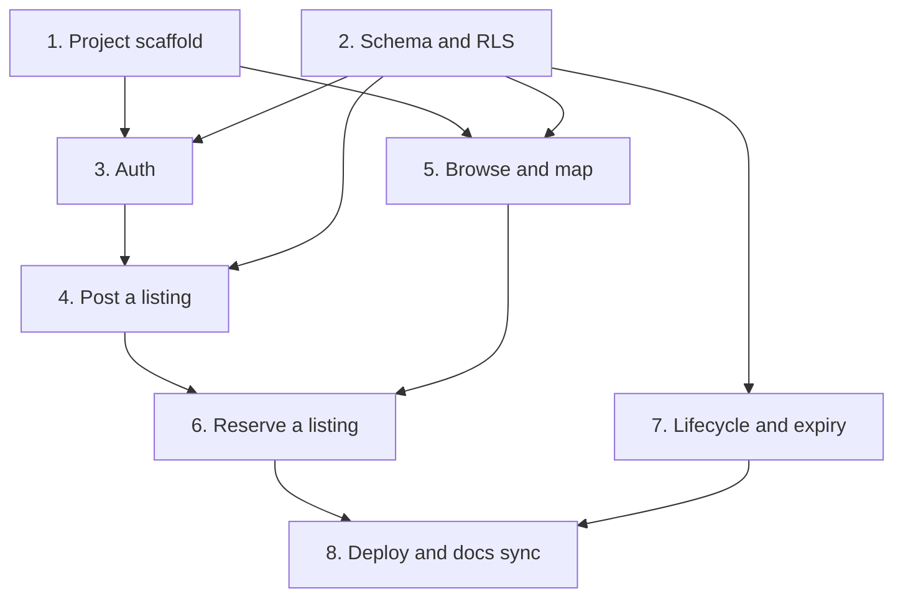

# MVP — Rollout

**Architecture:** [00-architecture.md](00-architecture.md) · **Decisions:** [gaps-and-decisions.md](gaps-and-decisions.md) · **Chapters:** [chapters/](chapters/)

---

## The four invariants

1. **No custom backend server.** All data access is the Supabase JS client from the browser, governed
   by RLS. The only server-side code is SQL (schema, policies, the `pg_cron` function), versioned under
   `supabase/`.
2. **No service that needs a billed API key.** Supabase free tier, OSM tiles, Nominatim, Google OAuth
   (free), Cloudflare Pages. If a chapter's design needs one, that's a stop-and-flag, not a workaround.
3. **Browsing stays public.** Login gates exactly two actions — posting and reserving — never read access.
4. **Independently shippable.** After each chapter, `main` builds, deploys, and the app works end-to-end
   for whatever has shipped so far (e.g. after chapter 5 you can browse seeded listings anonymously;
   the "Reserve" button only appears once chapter 6 ships).
5. **No inline UI strings.** Every chapter that adds a component routes its copy through `t(key)` into
   `strings.de.ts` (scaffolded in chapter 1) rather than hardcoding German text inline — see
   [00-architecture.md §11](00-architecture.md#11-ui-language).

---

## Dependency graph



Chapters 1 and 2 have no dependency on each other. Chapter 5 (public browsing) does not depend on
auth (chapter 3) — only chapter 4 (posting, which requires a signed-in seller) does. Chapter 7
(expiry) is schema-only and can proceed any time after chapter 2, in parallel with 3–6.

---

## Chapters

| # | Chapter | Layer | Gate | Plan | Status |
| --- | --- | --- | --- | --- | --- |
| 1 | Project scaffold + i18n dictionary | frontend | vitest + `./ci.sh` | [01-project-scaffold.md](chapters/01-project-scaffold.md) | shipped |
| 2 | Database schema and RLS | schema | `supabase db` smoke script | [02-schema-and-rls.md](chapters/02-schema-and-rls.md) | shipped |
| 3 | Auth (Google sign-in) | frontend + schema | vitest + `./ci.sh` | [03-auth.md](chapters/03-auth.md) | shipped |
| 4 | Post a listing | frontend + schema | vitest + `./ci.sh` | [04-post-a-listing.md](chapters/04-post-a-listing.md) | shipped |
| 5 | Browse and map | frontend | vitest + `./ci.sh` | [05-browse-and-map.md](chapters/05-browse-and-map.md) | shipped |
| 6 | Reserve a listing | frontend + schema | vitest + `./ci.sh` | [06-reserve-a-listing.md](chapters/06-reserve-a-listing.md) | shipped |
| 7 | Lifecycle and expiry | schema + frontend | `pg_cron` smoke script + `./ci.sh` | [07-lifecycle-and-expiry.md](chapters/07-lifecycle-and-expiry.md) | shipped |
| 8 | Deploy and docs sync | ops + docs | production smoke test | [08-deploy-and-docs-sync.md](chapters/08-deploy-and-docs-sync.md) | in progress |

"Shipped" means the chapter's code is merged to `main` and its refactor gate outcome is reported in the
chapter doc; "planned" means the chapter doc itself (Goal, design decisions, files, manual configuration,
tests, gate) is written but no code exists yet. Chapters 1–7 are shipped. Chapter 8 (deploy and docs sync)
is "in progress": the runbook is written and merged, but the manual dashboard configuration and the
production smoke test it depends on remain to be run by hand — see
[docs/operations/deploy.md](../../docs/operations/deploy.md) and the chapter's own status line. Chapters
1, 3 and 8 each carry a **Manual configuration** section for the Supabase dashboard, Google Cloud Console
and Cloudflare Pages steps that have no code equivalent; every other chapter's section explicitly says
none is needed, so the split is visible even where it's empty.

## Per-chapter gate

```bash
npm run lint && npm run typecheck && npm run test && npm run build
./ci.sh
```

Chapter 2 (and any chapter touching `supabase/migrations/`) additionally applies migrations to a local
Supabase instance (`supabase db reset`) and runs a smoke script asserting the RLS policies behave as
documented (anon can read, anon cannot write, owner can write, non-owner cannot).

**Refactor gate** (reported per chapter): components ~100 LOC, functions ~5 LOC bodies, at most one
level of nesting, commit at least once per green. Branches `feat/eggs-<chapter-slug>`, conventional
commits (`test: …` then `feat: …`), one PR per chapter, never commit to `main`.
