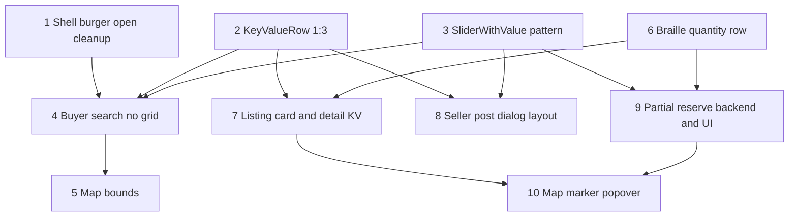

# Panel UX — Rollout

**Architecture:** [00-architecture.md](00-architecture.md) · **Decisions:** [gaps-and-decisions.md](gaps-and-decisions.md) · **Chapters:** [chapters/](chapters/) · **Ledger:** [run-ledger.md](run-ledger.md)

Chief-of-staff runs chapters via [`.cursor/skills/chief-of-staff/SKILL.md`](../../.cursor/skills/chief-of-staff/SKILL.md) (plan folder `.plans/panel-ux`).

---

## Git invariants

Orchestration: [`.cursor/skills/chief-of-staff/git-model.md`](../../.cursor/skills/chief-of-staff/git-model.md).

| Invariant | Rule |
| --- | --- |
| **Release branch** | **`main`** — plan docs live here; **one** MR/PR lands the full suite when all chapters are done. |
| **Loop branch** | One branch for the whole suite (e.g. `feat/plans-panel-ux`); every chapter merges here first. |
| **Start of every chapter** | `git checkout <loopBranch> && git pull` then `git checkout -b <branch from chapter doc>`. |
| **End of every chapter** | `./ci.sh` green → MR/PR **into `<loopBranch>`** → merge ([`.cursor/agents/chapter-implementer.md`](../../.cursor/agents/chapter-implementer.md)). |
| **End of suite** | Chief opens MR/PR **`<loopBranch>` → `main`** after all chapters are on the loop branch with green CI. |

---

## Product invariants

1. **Feature-folder layers** — containers orchestrate; components presentational; see architecture §4.
2. **Independently shippable** — each chapter merges with green `./ci.sh`.
3. **Chakra-only for touched UI** — Slider, Combobox, Popover, Field; no raw `<input>`/`<select>` in edited files.
4. **TDD pair per chapter** — happy + negative in Red tests table before Green.
5. **Refactor gate** — report outcome per chapter.
6. **German copy** via `strings.de.ts` only.
7. **Schema** — only chapter 9 touches `supabase/`.

---

## Dependency graph



---

## Chapters

| # | Chapter | Gate | Plan | Status |
| --- | --- | --- | --- | --- |
| 1 | Shell burger, open panel, cleanup | `./ci.sh` | [01-shell-burger-open-cleanup.md](chapters/01-shell-burger-open-cleanup.md) | planned |
| 2 | KeyValueRow 1:3 | `./ci.sh` | [02-key-value-row-ratio.md](chapters/02-key-value-row-ratio.md) | planned |
| 3 | SliderWithValue | `./ci.sh` | [03-slider-with-value.md](chapters/03-slider-with-value.md) | planned |
| 4 | Buyer search only | `./ci.sh` | [04-buyer-search-only.md](chapters/04-buyer-search-only.md) | planned |
| 5 | Map radius bounds | `./ci.sh` | [05-map-radius-bounds.md](chapters/05-map-radius-bounds.md) | planned |
| 6 | Braille quantity | `./ci.sh` | [06-braille-quantity-row.md](chapters/06-braille-quantity-row.md) | planned |
| 7 | Listing card + detail KV | `./ci.sh` | [07-listing-card-detail-kv.md](chapters/07-listing-card-detail-kv.md) | planned |
| 8 | Seller post dialog | `./ci.sh` | [08-seller-post-dialog.md](chapters/08-seller-post-dialog.md) | planned |
| 9 | Partial reserve | `./ci.sh` + rls-smoke | [09-partial-reserve.md](chapters/09-partial-reserve.md) | planned |
| 10 | Map listing popover | `./ci.sh` | [10-map-listing-popover.md](chapters/10-map-listing-popover.md) | planned |

## Per-chapter gate

```bash
./ci.sh
```

Chapter 9: ensure migration applies locally and **rls-smoke** workflow passes on PR.

---

## Execution order (chief of staff)

1. [chapters/01-shell-burger-open-cleanup.md](chapters/01-shell-burger-open-cleanup.md)
2. [chapters/02-key-value-row-ratio.md](chapters/02-key-value-row-ratio.md)
3. [chapters/03-slider-with-value.md](chapters/03-slider-with-value.md)
4. [chapters/04-buyer-search-only.md](chapters/04-buyer-search-only.md)
5. [chapters/05-map-radius-bounds.md](chapters/05-map-radius-bounds.md)
6. [chapters/06-braille-quantity-row.md](chapters/06-braille-quantity-row.md)
7. [chapters/07-listing-card-detail-kv.md](chapters/07-listing-card-detail-kv.md)
8. [chapters/08-seller-post-dialog.md](chapters/08-seller-post-dialog.md)
9. [chapters/09-partial-reserve.md](chapters/09-partial-reserve.md)
10. [chapters/10-map-listing-popover.md](chapters/10-map-listing-popover.md)
