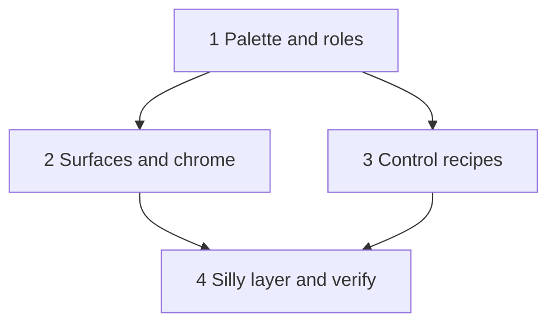

# Playful Theme — Rollout

**Architecture:** [00-architecture.md](00-architecture.md) · **Decisions:** [gaps-and-decisions.md](gaps-and-decisions.md) · **Chapters:** [chapters/](chapters/) · **Ledger:** [run-ledger.md](run-ledger.md)

Chief-of-staff runs chapters via [`.cursor/skills/chief-of-staff/SKILL.md`](../../.cursor/skills/chief-of-staff/SKILL.md) (plan folder `.plans/playful-theme`).

**Loop branch:** `feat/plans-playful-theme`

---

## Git invariants

Orchestration: [`.cursor/skills/chief-of-staff/git-model.md`](../../.cursor/skills/chief-of-staff/git-model.md).

| Invariant | Rule |
| --- | --- |
| **Release branch** | **`main`** — plan docs live here before the loop starts; **one** PR lands the full suite when all chapters are done. |
| **Loop branch** | **`feat/plans-playful-theme`** — cut from pulled `main`; every chapter merges here first. |
| **Start of every chapter** | `git checkout feat/plans-playful-theme && git pull` then `git checkout -b <branch from chapter doc>`. |
| **End of every chapter** | `./ci.sh` green → PR **into `feat/plans-playful-theme`** → merge ([`.cursor/agents/chapter-implementer.md`](../../.cursor/agents/chapter-implementer.md)). |
| **End of suite** | Chief opens PR **`feat/plans-playful-theme` → `main`** after all chapters are on the loop branch with green CI. |

---

## Product invariants

1. **tdd-workflow** — red → green → refactor, one commit per green; files ≤~100 LOC, methods ≤~5 LOC, ≤1 nesting level, rule of three.
2. **Independently shippable** — each chapter merges with green `./ci.sh`.
3. **Roles, not swatches** — features reference role palettes (`primary`, `danger`, …); only `theme/` names raw swatches.
4. **Chakra-only** for touched UI; **no new npm dependencies**.
5. **German copy** via `strings.de.ts` only.
6. **Reduced motion** — every animation gated by `prefers-reduced-motion`.
7. **AA contrast** — role pairs pass the contrast test in light and dark.
8. **TDD pair per chapter** — happy + negative in Red tests before Green; report refactor-gate outcome.

---

## Dependency graph



---

## Chapters

| # | Chapter | Gate | Plan | Status |
| --- | --- | --- | --- | --- |
| 1 | Palette and roles | `./ci.sh` | [01-palette-and-roles.md](chapters/01-palette-and-roles.md) | planned |
| 2 | Surfaces and chrome | `./ci.sh` | [02-surfaces-and-chrome.md](chapters/02-surfaces-and-chrome.md) | planned |
| 3 | Control recipes | `./ci.sh` | [03-control-recipes.md](chapters/03-control-recipes.md) | planned |
| 4 | Silly layer and verify | `./ci.sh` | [04-silly-layer-and-verify.md](chapters/04-silly-layer-and-verify.md) | planned |

## Per-chapter gate

```bash
./ci.sh
```

---

## Execution order (chief of staff)

1. [chapters/01-palette-and-roles.md](chapters/01-palette-and-roles.md)
2. [chapters/02-surfaces-and-chrome.md](chapters/02-surfaces-and-chrome.md)
3. [chapters/03-control-recipes.md](chapters/03-control-recipes.md)
4. [chapters/04-silly-layer-and-verify.md](chapters/04-silly-layer-and-verify.md)
