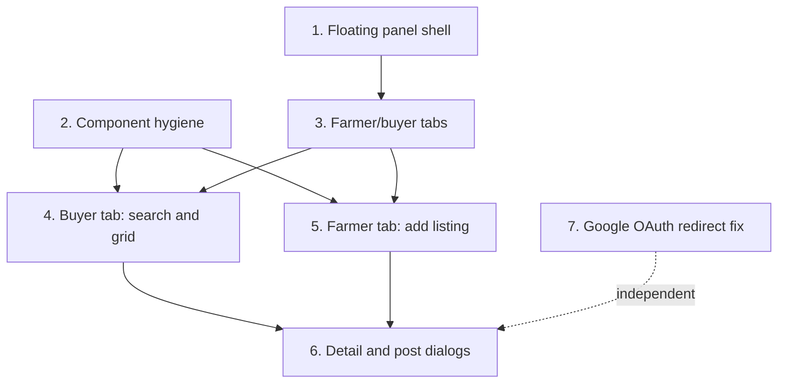

# UI overhaul — Rollout

**Architecture:** [00-architecture.md](00-architecture.md) · **Decisions:** [gaps-and-decisions.md](gaps-and-decisions.md) · **Chapters:** [chapters/](chapters/)

---

## The five invariants

1. **No schema or backend change.** Nothing under `supabase/` is touched by this folder; every RPC,
   table, and RLS policy from `.plans/mvp/` is used exactly as-is.
2. **Chakra-only UI.** Every new or touched interactive element is a Chakra component — no raw
   `<select>`/`<label>`/`<input>` (see [00-architecture.md §5](00-architecture.md#5-component-library-convention)).
   A chapter that adds or edits form markup is not done until this holds for the whole file it
   touched, not just the lines it added.
3. **`/post` and `/listings/:id` keep working as deep links.** Converting them to dialogs (chapter
   6) must not break loading either URL directly — see
   [00-architecture.md §8](00-architecture.md#8-dialogs-not-pages-for-detail-and-posting).
4. **Independently shippable.** After each chapter, `main` builds, deploys, and the app works
   end-to-end for whatever has shipped so far — e.g. after chapter 4 alone, the buyer tab shows a
   grid inside the floating panel even though the farmer tab and dialogs haven't shipped yet.
5. **No inline UI strings.** Every new string goes through `t(key)` into `strings.de.ts`, per
   `.plans/mvp/01-rollout.md`'s invariant 5 — this folder doesn't relax that rule.

---

## Dependency graph



Chapters 1 and 2 have no dependency on each other and can ship in either order. Chapter 7 (the auth
fix) has no dependency on anything in this folder and can land first, last, or in parallel — it's
listed last only because it's the smallest, most isolated chapter.

---

## Chapters

| # | Chapter | Layer | Gate | Plan | Status |
| --- | --- | --- | --- | --- | --- |
| 1 | Floating panel shell | frontend | vitest + `./ci.sh` | [01-floating-panel-shell.md](chapters/01-floating-panel-shell.md) | in review |
| 2 | Component hygiene | frontend | vitest + `./ci.sh` | [02-component-hygiene.md](chapters/02-component-hygiene.md) | planned |
| 3 | Farmer/buyer tabs | frontend | vitest + `./ci.sh` | [03-farmer-buyer-tabs.md](chapters/03-farmer-buyer-tabs.md) | planned |
| 4 | Buyer tab: search and grid | frontend | vitest + `./ci.sh` | [04-buyer-tab-search-and-grid.md](chapters/04-buyer-tab-search-and-grid.md) | planned |
| 5 | Farmer tab: add listing | frontend | vitest + `./ci.sh` | [05-farmer-tab-add-listing.md](chapters/05-farmer-tab-add-listing.md) | planned |
| 6 | Detail and post dialogs | frontend | vitest + `./ci.sh` | [06-detail-and-post-dialogs.md](chapters/06-detail-and-post-dialogs.md) | planned |
| 7 | Google OAuth redirect fix | frontend + ops | vitest + `./ci.sh` | [07-google-oauth-redirect-fix.md](chapters/07-google-oauth-redirect-fix.md) | planned |

"Shipped" means the chapter's code is merged to `main` and its refactor gate outcome is reported in
the chapter doc; "planned" means the chapter doc itself (Goal, design decisions, files, manual
configuration, tests, gate) is written but no code exists yet — all seven chapters here are
currently "planned." Chapter 7 carries the only **Manual configuration** section with real content
(a Supabase dashboard fix); every other chapter's section explicitly says none is needed.

## Per-chapter gate

```bash
npm run lint && npm run typecheck && npm run test && npm run build
./ci.sh
```

No chapter in this folder touches `supabase/migrations/`, so unlike `.plans/mvp/`, no chapter here
needs `supabase db reset` or the RLS smoke script — the standard frontend gate above is sufficient
for all seven.

**Refactor gate** (reported per chapter): components ~100 LOC, functions ~5 LOC bodies, at most one
level of nesting, commit at least once per green — same limits as `.plans/mvp/01-rollout.md`.
Branches `feat/eggs-ui-<chapter-slug>`, conventional commits (`test: …` then `feat: …`), one PR per
chapter, never commit to `main`.
